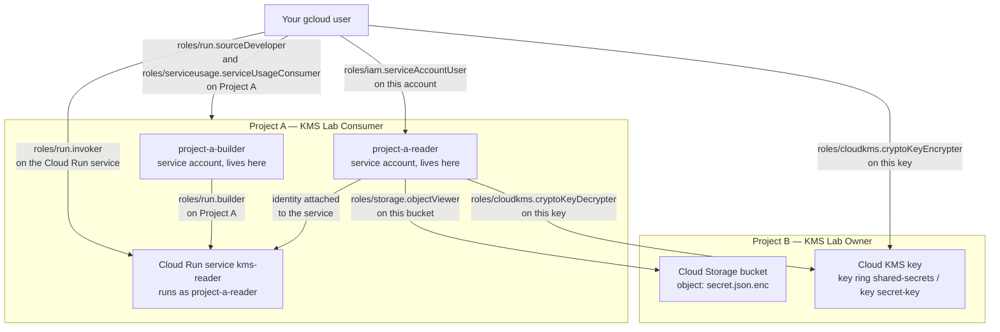
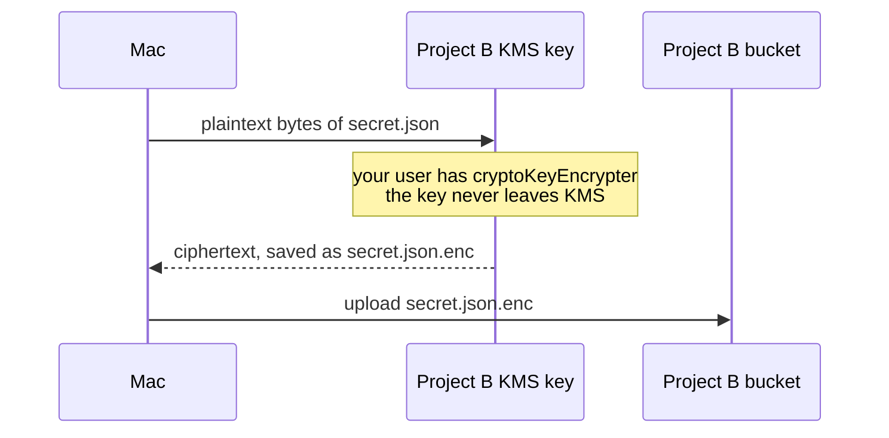
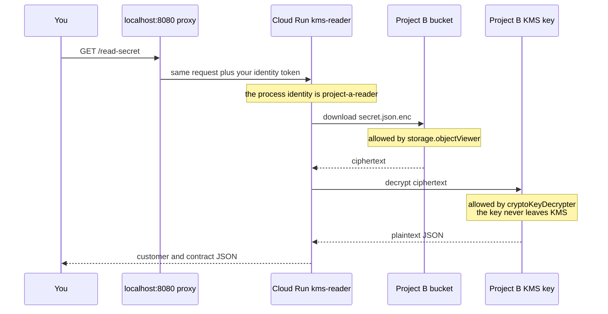

# Cross-project Cloud KMS lab

A Cloud Run service in **Project A** reads `secret.json.enc` from **Project B** and asks **Project B's** Cloud KMS key to decrypt it.

Both service accounts are created in Project A. A permission is a separate record, stored on the resource it protects. Project B allows Project A's runtime account by name. Project A does not need a copy of that account inside Project B.

Step-by-step commands are in [`docs/doc.md`](docs/doc.md). The service code is in [`cloudrun/`](cloudrun/).

## Architecture

`project-a-reader@PROJECT_A.iam.gserviceaccount.com` stays a Project A identity. The bucket policy and the key policy in Project B each list that email.

## Where each permission is stored

The project IAM page for Project A shows a principal only when that principal has a role on the project. `project-a-reader` has no role on Project A, so it does not appear there.

| Who | Role | Stored on |
| --- | --- | --- |
| `project-a-builder` | `roles/run.builder` | Project A |
| Your user | `roles/run.sourceDeveloper` | Project A |
| Your user | `roles/serviceusage.serviceUsageConsumer` | Project A |
| Your user | `roles/iam.serviceAccountUser` | The `project-a-reader` account itself |
| Your user | `roles/run.invoker` | The Cloud Run service `kms-reader` |
| Your user | `roles/cloudkms.cryptoKeyEncrypter` | Project B KMS key `secret-key` |
| `project-a-reader` | `roles/storage.objectViewer` | Project B bucket |
| `project-a-reader` | `roles/cloudkms.cryptoKeyDecrypter` | Project B KMS key `secret-key` |

`roles/iam.serviceAccountUser` lets you deploy Cloud Run as `project-a-reader`. It does not give `project-a-reader` any permission of its own.

## How the file is encrypted

This happens once, from your machine, before the service reads anything. `gcloud kms encrypt` accepts any file up to 64 KiB.

The plaintext file and the local ciphertext are deleted after the upload. The bucket keeps only `secret.json.enc`.

## How the file is read

The service is deployed with `--no-allow-unauthenticated`. `gcloud run services proxy` listens on `localhost:8080` and adds your identity token to each request. Cloud Run accepts it because you have `roles/run.invoker`.

`GET /` only checks that the service is up. It does not touch Project B.

Cloud Run supplies Application Default Credentials for `project-a-reader`. The app has no JSON key file.

## Names used in this lab

| Name | Value |
| --- | --- |
| Region | `europe-west2` |
| Runtime service account | `project-a-reader` |
| Build service account | `project-a-builder` |
| Cloud Run service | `kms-reader` |
| Bucket | `PROJECT_B-encrypted-data` |
| Key ring / key | `shared-secrets` / `secret-key` |
| Object | `secret.json.enc` |
